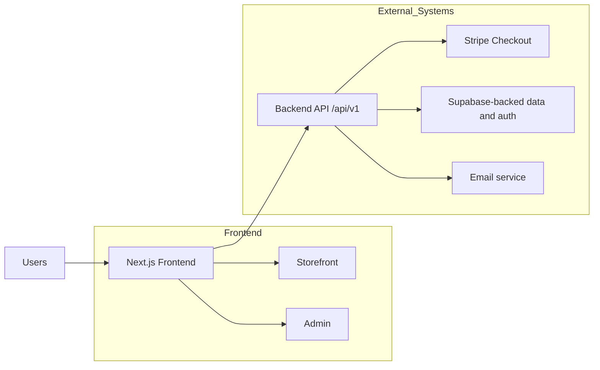
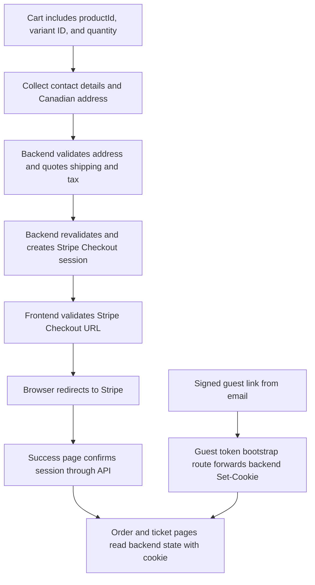
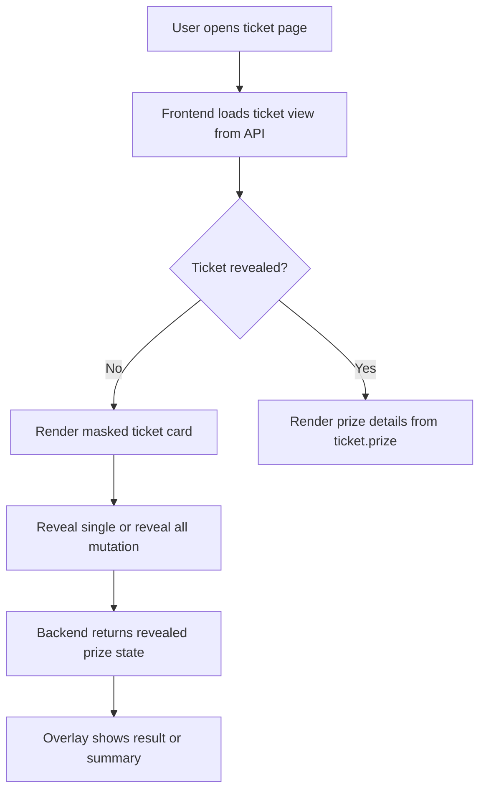
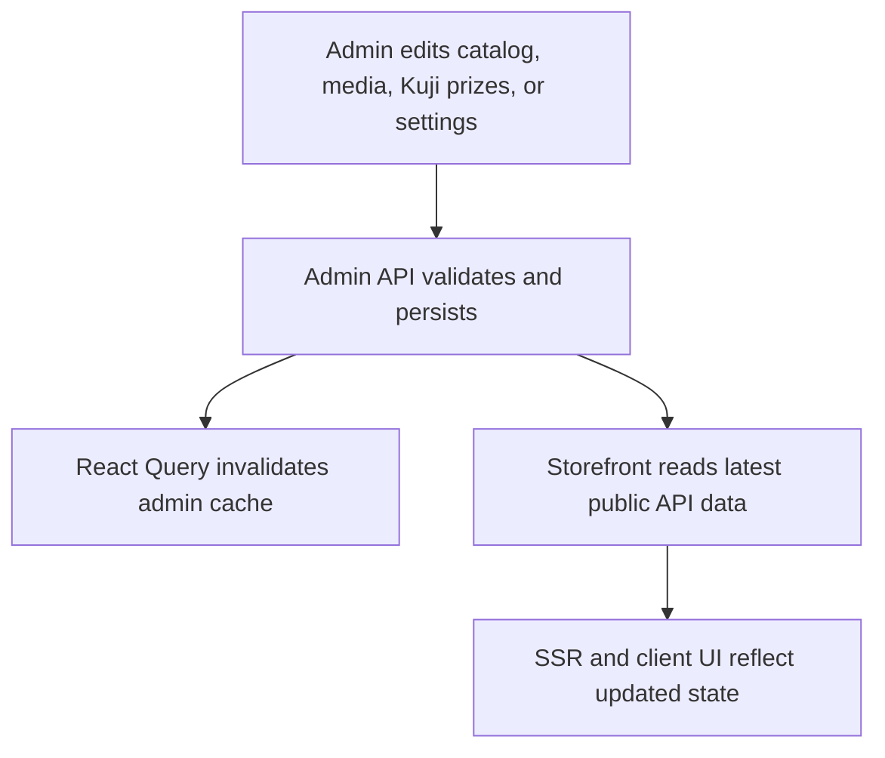

# PopBox Studio — Next.js Frontend

Production-oriented Next.js App Router frontend for a single-vendor anime merchandise and Ichiban Kuji storefront. The
app
renders the public storefront, customer accounts, guest order/ticket flows, and an authenticated admin UI while
consuming a separate
`/api/v1` backend for inventory, checkout, orders, and persistence.

For authentication details, see the [session policy](docs/auth-session-policy.md).

---

## Project Summary

PopBox Studio demonstrates frontend engineering for a real commerce surface:

- **SSR-first storefront** for homepage, listings, collections, product detail pages, legal/content pages, and
  SEO-critical
  routes.
- **Interactive client islands** for cart, wishlist, checkout handoff, search/autocomplete, drawers, admin CRUD, and
  Kuji
  ticket reveal.
- **Backend-owned commerce truth** for pricing, inventory, order state, Stripe Checkout, Kuji ticket allocation, and
  prize
  reveal results.
- **Cookie-backed guest order access** where a token bootstrap route forwards backend `Set-Cookie` headers and
  subsequent
  order/ticket reads rely on cookies.
- **Admin workflows** for products, variants, images, collections, tags, orders, legal content, shipping settings,
  and store banner settings.

No production live-site URL is declared in this repository. Local and deployment URLs are configured through environment
variables.

---

## Tech Stack

| Area               | Choices                                                                                            |
|--------------------|----------------------------------------------------------------------------------------------------|
| Framework          | Next.js App Router, React 19                                                                       |
| Language           | TypeScript                                                                                         |
| Styling            | Tailwind CSS v4, shadcn-style primitives, Radix UI, CVA, `tailwind-merge`                          |
| Server/client data | Axios, TanStack Query, centralized query/mutation configs                                          |
| Client state       | Zustand persisted cart and wishlist stores                                                         |
| Forms/validation   | React Hook Form, Zod, local validation helpers                                                     |
| Auth               | Supabase SSR sessions, customer/admin classification, and Bearer-authenticated backend APIs        |
| Payments           | Stripe Checkout handoff through backend API responses                                              |
| Observability      | Sentry, consent-gated Google Analytics 4 ecommerce events, Vercel Analytics, Vercel Speed Insights |
| Testing            | Vitest, Testing Library, MSW, Playwright                                                           |

Runtime: Node.js **24.x**.

---

## Key Frontend Capabilities

**Customer storefront**

- Homepage, products, search, collections, product detail pages, cart, checkout success, about/contact/FAQ/legal pages.
- Standard and Kuji product display with inventory-aware UI.
- Standard variant selection, variant-aware cart persistence, a product wishlist, and variant-specific price and
  availability display.
- Customer sign-up/sign-in, Google sign-in, email confirmation, password recovery, profile, order history, and Kuji
  history.
- Canadian address entry with optional Google Places suggestions, backend address correction confirmation, and backend
  quotes for shipping, tax, and totals before Stripe handoff.
- Guest order detail and Kuji ticket pages protected by backend-issued cookie sessions.
- Kuji single-ticket and reveal-all flows with video overlay, waiting state, summary state, and backend-sourced prize
  data.

**Admin workflows**

- Supabase session gate for `/admin`.
- Product create/edit, variant inventory management, media upload/delete/reorder, Kuji prize management, collection/tag
  management and ordering.
- Order list/detail, status updates, shipment updates, refunds, resend confirmation action.
- Legal/FAQ editor, location-based shipping settings, and storefront banner settings.

**Quality and platform**

- `next/image` with Supabase storage remote patterns and fallback image states.
- Metadata helpers, canonical URLs, dynamic sitemap, robots rules, Product JSON-LD, FAQ JSON-LD, and homepage WebSite
  JSON-LD.
- Loading skeletons, empty/error states, toast feedback, guarded checkout interactions, and responsive layouts.

---

## Architecture Overview

| Layer                          | Responsibility                                                                                      |
|--------------------------------|-----------------------------------------------------------------------------------------------------|
| `app/(store)`                  | Public storefront routes, SEO metadata, guest order pages, Kuji ticket pages                        |
| `app/(admin)`                  | Authenticated admin routes and admin-only metadata/noindex behavior                                 |
| `app/(store)/account`          | Customer authentication, profile, order history, and Kuji history                                   |
| Server Components              | Default page/rendering layer for initial HTML and server-safe public API reads                      |
| Client Components              | Cart/wishlist state, React Query, forms, drawers, checkout handoff, admin CRUD, Kuji reveal         |
| `lib/api/public-storefront.ts` | Server-only Axios reads to the backend for storefront SSR/RSC use cases                             |
| `configs/api/*`                | Client query/mutation request definitions used by React Query hooks                                 |
| Backend API                    | Separate `/api/v1` service that owns validation, inventory, payments, order state, and Kuji results |



---

## Core Flows

**Checkout and guest order access**



The success page waits for backend webhook finalization before presenting a paid order. Signed-in checkout uses customer
Bearer authentication; the backend owns order linkage and payment state.

**Ichiban Kuji reveal**



**Admin to storefront**



---

## Local Setup

Requirements: Node.js 24.x, pnpm 10.30.2, and the separate PopBox backend running on port 3000 for local API flows.

```bash
cp .env.example .env.local
# Set NEXT_PUBLIC_API_BASE_URL=http://localhost:3000 and fill in public credentials.
pnpm install
pnpm dev
```

Dev server: [http://localhost:3001](http://localhost:3001)

For production-style local runs:

```bash
pnpm build
pnpm start --port 3001
```

`pnpm start` without a port argument uses Next.js's default port 3000, which conflicts with the local backend.

---

## Environment Variables

Use `.env.local` locally. `.env.example` shows the required public configuration.

| Variable                               | Purpose                                                                                                                       |
|----------------------------------------|-------------------------------------------------------------------------------------------------------------------------------|
| `NEXT_PUBLIC_API_BASE_URL`             | Backend origin for `/api/v1`; required in production, defaults to `http://localhost:3000` in dev                              |
| `NEXT_PUBLIC_SITE_URL`                 | Canonical site URL for metadata and absolute URLs                                                                             |
| `NEXT_PUBLIC_STRIPE_PUBLISHABLE_KEY`   | Stripe publishable key                                                                                                        |
| `NEXT_PUBLIC_GOOGLE_CLIENT_ID`         | Public Google OAuth web client ID used by Google Identity Services                                                            |
| `NEXT_PUBLIC_GOOGLE_MAPS_API_KEY`      | Optional browser key for Google Places address suggestions; restrict it to authorized site origins and the required Maps APIs |
| `NEXT_PUBLIC_GA_MEASUREMENT_ID`        | Optional GA4 measurement ID; analytics loads after consent on the storefront                                                  |
| `NEXT_PUBLIC_GA_DEBUG`                 | Set to `true` to enable GA4 in non-production environments and DebugView                                                      |
| `NEXT_PUBLIC_SUPABASE_URL`             | Supabase project URL                                                                                                          |
| `NEXT_PUBLIC_SUPABASE_PUBLISHABLE_KEY` | Supabase publishable key used by browser and SSR auth clients                                                                 |
| `NEXT_PUBLIC_SUPABASE_STORAGE_BUCKET`  | Public product-image bucket; defaults to `product-images`                                                                     |
| `NEXT_PUBLIC_IS_SITE_OPEN`             | Set to `false` for maintenance-style storefront gating                                                                        |

On Vercel, `VERCEL_PROJECT_PRODUCTION_URL` or `VERCEL_URL` can back `NEXT_PUBLIC_SITE_URL` when it is not explicitly
set.

Customer authentication also requires Supabase email confirmation, password recovery, and (when enabled) the Google
provider. `NEXT_PUBLIC_GOOGLE_CLIENT_ID` must be the same web client ID configured on the Supabase Google provider;
never expose its client secret. Add `http://localhost:3001`, `https://popboxstudio.com`, and
`https://www.popboxstudio.com` as Authorized JavaScript origins on that Google OAuth web client. Keep
`http://localhost:3001/auth/callback` plus the production `/auth/callback` URL allowlisted in Supabase Auth for email
confirmation and password recovery.
Configure a production SMTP provider before relying on confirmation and recovery email volume.

Google Places suggestions are optional. The backend separately needs its private `GOOGLE_ADDRESS_VALIDATION_API_KEY`
to validate checkout addresses. Keep service-role keys, Stripe secret keys, and private address-validation credentials
out
of `NEXT_PUBLIC_*` variables.

---

## Quality Checks

| Command                  | Purpose                                                                    |
|--------------------------|----------------------------------------------------------------------------|
| `pnpm test`              | Vitest unit/component tests                                                |
| `pnpm test:e2e`          | Playwright desktop/mobile browser flows and visual checks                  |
| `pnpm test:e2e:update`   | Regenerate Playwright visual snapshots after reviewing intended UI changes |
| `pnpm build`             | Production Next.js build                                                   |
| `pnpm exec tsc --noEmit` | TypeScript typecheck                                                       |
| `pnpm check`             | Repo quality command: lint with fixes, tests, and build                    |

Note: `pnpm lint` is configured as `eslint . --fix`, so inspect diffs after running `pnpm check`.

Before the first browser test run, install Chromium with `pnpm exec playwright install chromium`. Playwright starts a
separate Next.js dev build in `.next-playwright`; use a free port (default 3001, override with `PLAYWRIGHT_PORT`) to
avoid
reusing a normal dev server. Browser tests run separately from `pnpm check`. CI runs `pnpm check` on Node.js 24.

---

## Folder Structure

```text
app/                 # App Router route groups, layouts, metadata, loading/error boundaries
components/          # UI primitives, storefront, admin, cart, wishlist, Kuji components
configs/             # Public env and API query/mutation configs
hooks/               # React Query wrappers, Zustand stores, checkout/search/mobile hooks
interfaces/          # Shared TypeScript contracts for API payloads
lib/                 # Server-safe API reads, SEO helpers, filters, Sentry, Supabase client
tests/               # Vitest, Testing Library, MSW-backed coverage
public/              # Static images/video used by storefront and Kuji reveal UI
```

---

## Documentation

- [Authentication session policy](docs/auth-session-policy.md) documents customer/admin session handling and hosted auth
  configuration.
- Backend behavior is described only where the frontend integrates with it; the backend repository remains the source of
  truth for persistence, inventory, payment, email, and webhook implementation details.
